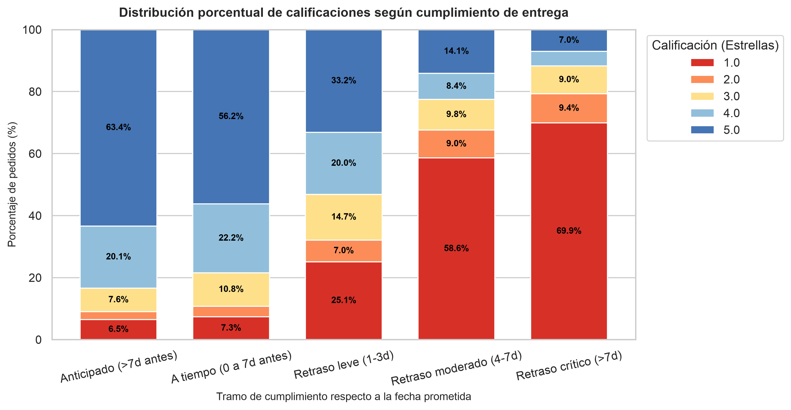
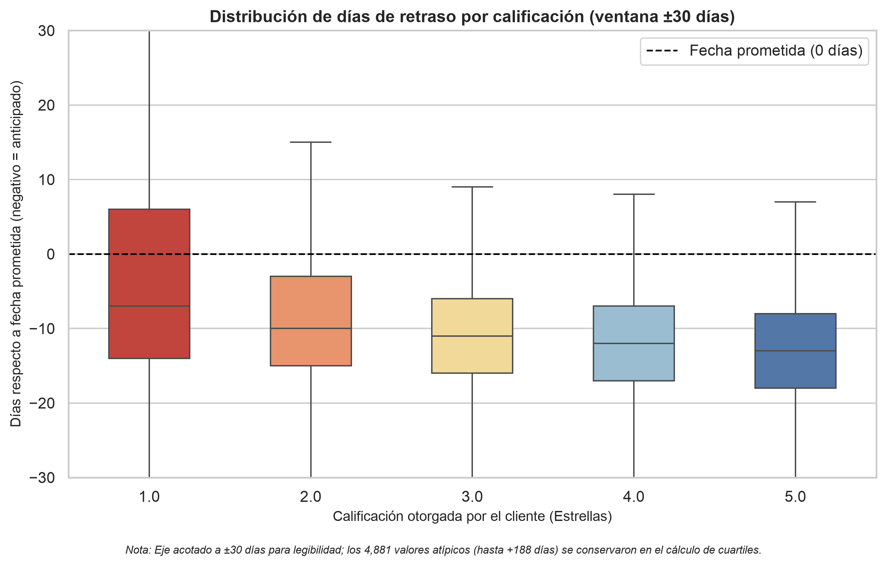
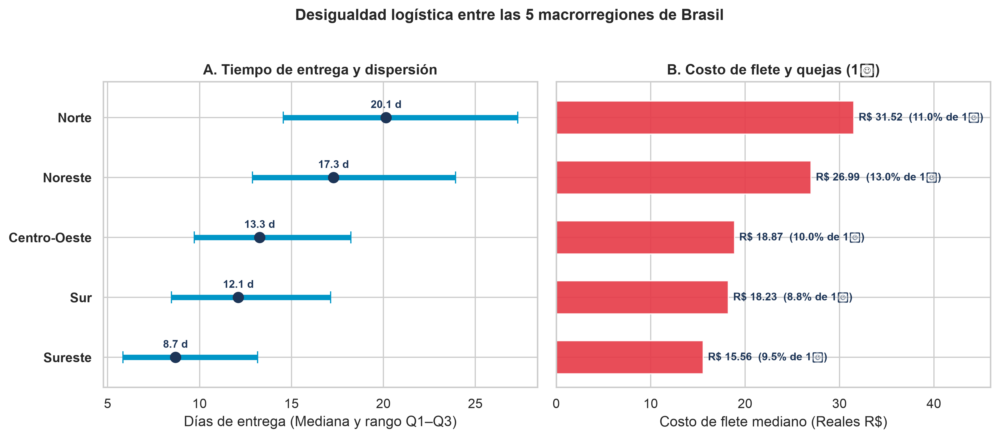
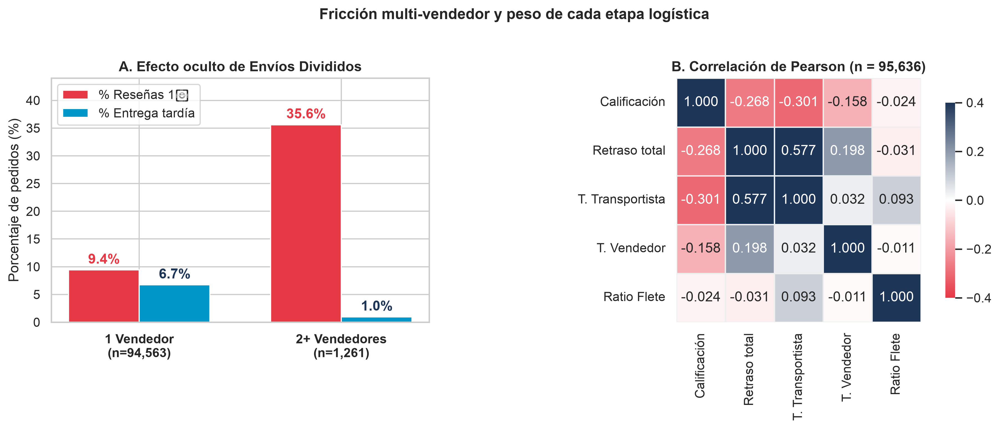

# MEMCD-Mod1-Proyecto

Repositorio del equipo conformado por: Adamary Nieves Azpeitia, Gibran Flores González, Gerardo Balderas Velázquez, Jesús Yahir Hernandez Muñoz y Eddy Emmanuel Asturiano Peralta

## Objetivo

Analizar la relación entre el desempeño logístico y la satisfacción
de los clientes de Olist, considerando el cumplimiento de los tiempos
de entrega, las diferencias logísticas regionales, la participación
de múltiples vendedores y el valor económico de los pedidos, con
la finalidad de identificar oportunidades de mejora operativa.

## Resultados

A partir del análisis exploratorio de 95,824 pedidos entregados
y evaluados, se identificaron los siguientes hallazgos:

- Los pedidos entregados a tiempo obtuvieron una calificación promedio de 4.29 estrellas, frente a 2.27 de los pedidos tardíos (con mediana de 1 estrella). La asociación no es lineal: mientras el pedido llegue dentro de la fecha prometida, las reseñas de 1 estrella se mantienen entre 6.5% y 7.3%; con un retraso de 1 a 3 días suben a 25.1%, y con más de 4 días pasan a ser la respuesta mayoritaria (58.6% a 69.9%).

- Los pedidos con 1 estrella presentan una mediana de retraso mucho más cercana a la fecha prometida y una dispersión considerablemente mayor que los de 5 estrellas, cuya entrega suele anticiparse. Las correlaciones de Spearman confirman una asociación negativa con la calificación, más fuerte para el tiempo de entrega (ρ = -0.23) que para el retraso en días (ρ = -0.06).

- Los clientes del Norte y el Noreste esperan más del doble de tiempo (mediana de 17.3 a 20.1 días frente a 8.7 en el Sureste) y pagan casi el doble de flete mediano (R$ 27.0 a R$ 31.5 frente a R$ 15.6). El Noreste concentra además la mayor proporción de reseñas de 1 estrella (13.0%, frente a 8.8% en el Sur y 9.5% en el Sureste).

- Los pedidos surtidos por 2 o más vendedores (n = 1,261) casi no se entregan tarde (1.0%), pero reciben 1 estrella en 35.6% de los casos, frente a 9.4% en pedidos de un solo vendedor, posiblemente por envíos parciales. Por etapa, el tiempo del transportista se asocia casi el doble con la calificación (r = -0.30) que el tiempo de despacho del vendedor (r = -0.16).


Los resultados corresponden a un análisis exploratorio y no
implican necesariamente relaciones de causalidad.

## Cómo reproducir el análisis

El proyecto fue ejecutado y validado con Python 3.15.1,
utilizando Jupyter Notebook en Visual Studio Code.

### 1. Clonar el repositorio

```bash
git clone https://github.com/1304003/MEMCD-Mod1-Proyecto
cd MEMCD-Mod1-Proyecto
```

### 2. Crear un entorno virtual

```bash
python -m venv projmod1
```

Activar el entorno en macOS o Linux:

```bash
source projmod1/bin/activate
```

En Windows:

```powershell
.\projmod1\Scripts\Activate.ps1
```

### 3. Instalar las dependencias

```bash
python -m pip install -r requirements.txt
```

Verificar la compatibilidad de las dependencias instaladas:

```bash
python -m pip check
```

### 4. Obtener los datos

Los datos utilizados provienen del repositorio público de Olist:

`https://github.com/olist/work-at-olist-data`

Para garantizar la reproducibilidad de la fuente, se utiliza
el commit:

`d9e49802f3e92d09ee94ab9ccc5e457f207a8959`

El notebook descarga automáticamente los archivos necesarios
cuando estos no se encuentran disponibles en `data/raw/`.

#### Licencia y condiciones de uso

Los datos pertenecen al conjunto [Brazilian E-Commerce Public Dataset by Olist](https://www.kaggle.com/datasets/olistbr/brazilian-ecommerce),
publicado bajo la licencia [CC BY-NC-SA 4.0](https://creativecommons.org/licenses/by-nc-sa/4.0/deed.es).

Su utilización en este proyecto tiene fines exclusivamente
académicos y no comerciales. Los archivos originales se
conservan sin modificaciones y las transformaciones se
realizan sobre una base procesada independiente.

Los datos derivados que se distribuyan conservarán las
condiciones de la licencia original.

### 5. Ejecutar el notebook

Abrir el archivo:

`notebooks/01_analisis_exploratorio_olist.ipynb`

El notebook incluye la identificación del entorno de ejecución,
la obtención de datos, su limpieza, transformación, análisis
estadístico y generación de visualizaciones.

## Aportaciones de cada participante

- **Adamary Nieves Azpeitia:** desarrollo de funciones para el análisis
  estadístico descriptivo, aplicación de pruebas de normalidad y de
  comparación de distribuciones entre pedidos puntuales y tardíos.
  Análisis de correlaciones entre las variables de interés, elaboración
  de estadísticas descriptivas por región y estado, e interpretación
  de los resultados estadísticos.

- **Gibran Flores González:** consolidación de la información a nivel
  de pedido único para el análisis visual, cálculo de indicadores
  logísticos por etapa y macrorregión, y desarrollo de las cuatro
  visualizaciones principales mediante Matplotlib y Seaborn.
  Interpretación de los hallazgos gráficos, documentación de sus
  limitaciones y exportación de las visualizaciones.

- **Gerardo Balderas Velázquez:** contextualización del problema,
  formulación de la pregunta de investigación, definición de los
  objetivos, alcance y unidad de observación del análisis.
  Revisión metodológica, documentación del entorno de ejecución,
  validación de la reproducibilidad y actualización final del README.

- **Jesús Yahir Hernandez Muñoz:** diagnóstico de la calidad de los
  datos, tratamiento de valores faltantes, depuración de reseñas
  repetidas, integración de tablas, tratamiento de valores atípicos
  e identificación de inconsistencias cronológicas.
  Construcción de la base de datos limpia, justificación de las
  decisiones de transformación y cuantificación de sus efectos
  sobre los registros y el valor económico de los pedidos.

- **Eddy Emmanuel Asturiano Peralta:** configuración inicial del
  repositorio Git, organización de la estructura de archivos y
  carpetas, documentación preliminar del README y desarrollo de
  código para identificar valores faltantes y negativos en los
  precios durante la exploración inicial de los datos.
